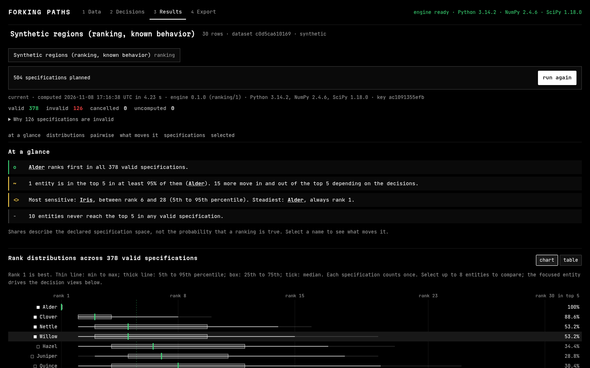

# Forking Paths

Inspect how analytical choices change a ranking or a statistical finding, then export enough evidence to reproduce every displayed result.

Forking Paths is a local browser application. You open an example or import a CSV, inspect the data before accepting it, declare the decisions an analyst could reasonably make (with a rationale for each alternative), and run every resulting specification. The results show which choices move a ranking or an estimate, and any single specification can be opened to see its exact inputs, exclusions, method and diagnostics. A project bundle carries the original bytes, the accepted data, the plans and the results; the command-line tool reproduces it with the same engine.

It works without a model API, a login, or cloud storage. Data stays in the browser.



## Quick start

Requires Node 20+, and Python 3.10+ with NumPy and SciPy for the CLI and tests.

```bash
npm install
npm run setup:runtime     # copies Pyodide and downloads the pinned NumPy/SciPy wheels (SHA-256 checked) into public/pyodide
npm run dev               # http://localhost:5173, opens on the synthetic ranking example
npm run build && npm run preview
```

`setup:runtime` is the only step that needs the network. After it, the app and its Python runtime are served locally and work offline.

## Workflows

### Ranking robustness

A table with one entity identifier and several numeric indicators. For each indicator you set the unit and whether higher or lower is better, then choose alternatives for:

| Decision | Options |
| --- | --- |
| normalization | min-max to [0, 1]; z-score (sample sd); percentile rank; ratio to best (x > 0) |
| missing values | exclude incomplete entities; impute the indicator median; impute the worst observed value |
| aggregation | weighted arithmetic mean; weighted geometric mean (strictly positive values only) |
| weights | declared fixed configurations, and seeded Dirichlet sampling with optional per-weight bounds |

Explicit rules cover constant indicators (the specification is invalid, or the indicator is dropped and weights renormalized), ties (best rank or average rank), and invalid values. Scores are rounded to 12 significant digits before ranking so floating-point noise never breaks a tie.

Views: rank distributions per entity (chart and equivalent table), pairwise ordering, what moves a selected entity (rank by decision option, weight and rank correlation, weight and rank scatter), every specification with its status, and the selected specification's raw values, normalized values, contributions and final scores.

A top-k fraction is the share of evaluated specifications, under the declared sampling scheme, in which the entity ranks in the top k. It is not the probability that a ranking is true, and sampled weights do not define a confidence interval.

### Relationship robustness

A restricted family of linear regressions on the same engine. The effect is the ordinary least squares coefficient of the predictor: the change in the outcome per one unit of the predictor, holding the chosen covariates fixed. Decisions: row filters, covariate sets, outlier rule, outcome transformation, and interval method.

- A log outcome estimates a different quantity, so it is a separate estimand and is never pooled with the untransformed coefficient.
- The declared sampling unit decides which intervals are valid. Independent rows: classical or HC3 t intervals, or a pairs bootstrap. Clustered rows: CR1 cluster-robust intervals (5 or more clusters) or a cluster bootstrap. Time-ordered or repeated rows: no interval method is offered, because none of these is valid there; estimates are still shown and labelled.
- The specification curve and its decision matrix show every tested alternative, with an accessible table.

Results are exploratory. The fraction of specifications with a positive estimate is not a posterior probability, and running many specifications does not correct for multiple testing or establish causation.

### Specification limit

You see the planned count before running and choose a maximum. When the plan exceeds it, a uniform random subset (seeded) is computed so no decision option is dropped wholesale. Valid, invalid, cancelled and uncomputed specifications are counted separately; invalid specifications carry their reason and are never silently discarded.

## Examples

| Example | Kind | What it verifies |
| --- | --- | --- |
| Synthetic regions | synthetic ranking with known behavior | Alder dominates every region and ranks first in every valid specification; Zephyr is always last; Birch rises only when cost carries a large weight; Cedar depends on the normalization; Elm and Fir always tie. The file has a duplicate row, a missing token and an unparseable value on purpose. |
| Synthetic training and errors | synthetic misleading aggregate | Within every department more training goes with fewer errors, but the pooled slope is positive. Adjusting for department reverses the sign. |
| EU-27 development indicators 2022 | real data, World Bank WDI, CC BY 4.0 | Six WDI series for the 27 EU member states. A simplified teaching adaptation, not an official index. Gross tertiary enrollment above 100% (Greece) and the missing Netherlands value show why indicator validity and the missing-data rule matter. |

Synthetic examples are generated by `engine/fpengine/examples.py` and a test checks that the committed CSV files match the generator. The WDI file is produced by `scripts/fetch_wdi.py`, which records the exact API URLs, retrieval date, WDI last-updated date and license in `public/examples/wdi-eu27-2022.provenance.json`. Values are copied unchanged.

## Architecture

```
engine/fpengine/   the only implementation of the numerical methods (Python, NumPy, SciPy)
  ranking.py         normalization, missing rules, aggregation, weights, ranks, summaries, pairwise, influence
  relationship.py    OLS, HC3 and CR1 variance, bootstrap, interval validity by sampling unit, estimands
  canonical.py       canonical JSON, the binary dataset hash shared with the TypeScript importer
  api.py             JSON entry points used by both the browser worker and the CLI
  __main__.py        CLI: info, examples, run, reproduce
src/worker/        Pyodide Web Worker that loads the same Python files; batched runs with progress and cancellation
src/lib/           CSV import and inspection, hashing, project model, bundles, report, IndexedDB persistence
src/components/    Data, Decisions, Results and Export views
scripts/           runtime setup, WDI retrieval, end-to-end checks, browser benchmark, clean-directory reproduction
bench/             engine benchmark and generated inputs
```

- **One numerical engine.** The browser runs `engine/fpengine` in Pyodide 314.0.7 (Python 3.14, NumPy 2.4.6, SciPy 1.18.0). The CLI runs the same files under CPython. There are no JavaScript copies of the formulas. The runtime is lazy-loaded the first time you run an analysis, with real loading stages shown.
- **Import.** CSV parsing and profiling happen once, in TypeScript, before the engine loads: column types, units, missing values, parse failures with row numbers, duplicates and ragged rows. The accepted table is stored as typed columns, and the original bytes are kept unchanged.
- **Hashes.** The dataset hash is defined over a binary encoding of the columns (float64 bytes, not number formatting), implemented in TypeScript and Python and tested against the same golden value. A hash identifies bytes; it does not prove where the data came from.
- **Versioned schemas.** `fp.source/1`, `fp.dataset/1`, `fp.plan/1`, `fp.result/1`, `fp.bundle/1`.
- **Cache and staleness.** A result's key covers the dataset hash, the computational plan (rationales and titles excluded), the algorithm version, seeds and the runtime versions. Changing a relevant input marks dependent results stale; stale results are labelled and excluded from exports.
- **Persistence.** The project autosaves to IndexedDB. Quota errors are shown, and the exported bundle is the reliable backup.
- **Imported bundles are data.** Schema, sizes and hashes are validated; nothing inside is executed. Reports escape all text. CSV exports neutralize spreadsheet formulas.

## Reproduction

```bash
# Python engine tests (independently derived fixtures, SciPy linregress, hand-computed values)
npm run test:py
# TypeScript tests (CSV import, formula protection, dataset hash parity)
npm test
# Reproduce an exported bundle with only the engine copied into an empty directory
scripts/reproduce-clean.sh project.fpbundle.json
# or directly
cd engine && python -m fpengine reproduce ../project.fpbundle.json
```

Tolerance: specification statuses and ranks must match exactly; scores within 1e-9 absolute; regression estimates and intervals within 1e-8 relative. A bundle exported from the browser (Python 3.14, NumPy 2.4.6) reproduces under CPython 3.12 with NumPy 1.26.4: maximum score difference 2.2e-16, maximum relative difference in regression estimates and bootstrap intervals 8.8e-14.

## Verification

| Check | Result |
| --- | --- |
| `npm run test:py` | 25 passed |
| `npm test` | 6 passed (including the cross-language dataset hash) |
| `npm run typecheck` | clean |
| `npm run build && npm run ui-check` | 42 of 42 browser checks (see `docs/ui-check.json` and [docs/VERIFICATION.md](docs/VERIFICATION.md)) |
| Browser vs CPython | identical rank, score and status digests (504 specifications of the synthetic example, Pyodide NumPy 2.4.6 vs CPython NumPy 1.26.4) |
| Benchmark | [docs/PERFORMANCE.md](docs/PERFORMANCE.md) |

## Screenshots

Captured from the running app by `npm run ui-check`:

- [Data inspection](docs/screenshots/desktop-1440-data.png), [decisions](docs/screenshots/desktop-1440-decisions.png), [ranking results](docs/screenshots/desktop-1440-ranking.png), [relationship results](docs/screenshots/desktop-1440-relationship.png), [WDI case study](docs/screenshots/desktop-1440-wdi.png) at 1440 px
- [1024 px](docs/screenshots/w1024-results.png), [768 px](docs/screenshots/w768-results.png), [390 px](docs/screenshots/w390-results.png)
- States: [engine loading](docs/screenshots/state-loading.png), [stale result](docs/screenshots/state-stale.png), [import error](docs/screenshots/state-import-error.png), [reproduced bundle](docs/screenshots/state-reproduced.png)

## Limitations

- Only the two documented workflows are supported. There is no time-series workflow; ordered data get estimates without intervals.
- The first run downloads about 16 MB of Python packages from the local server and takes several seconds to start the runtime.
- Large result matrices are kept in memory and in IndexedDB. A 10,000-entity, 512-specification run uses about 60 MB of matrices, and its bundle is about 85 MB.
- The CSV importer handles UTF-8 (with a Windows-1252 fallback) delimited text only.
- The browser was tested in headless Chromium on Linux. Other browsers, and Apple hardware, have not been tested.
- The WDI example is a teaching adaptation; it is not an official index and its indicator set is illustrative.

## License

MIT for the code. The WDI example data are licensed CC BY 4.0 by the World Bank.
